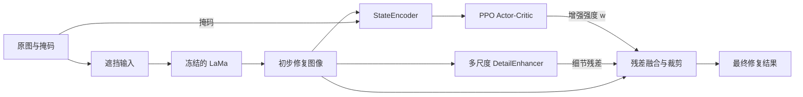

# DEAR-PPO

### 基于 PPO 的动漫图像修复细节增强

**简体中文** | [English](README_EN.md)

DEAR-PPO 在预训练的 **LaMa** 图像修复模型之后引入 **PPO（Proximal Policy Optimization，近端策略优化）**，根据图像状态选择细节增强强度，探索动漫图像中线条、纹理与整体观感的平衡。

项目采用“**LaMa 初步修复 → 固定多尺度细节提取 → PPO 自适应强度控制**”的流程，仅训练轻量的 Actor-Critic 网络，LaMa 主干保持冻结。

[修复效果](#修复效果) · [方法](#方法) · [快速开始](#快速开始) · [实验记录](#实验记录) · [局限与后续方向](#局限与后续方向)

## 修复效果

以下图片直接来自仓库的 [`outputs/repaired/`](outputs/repaired) 文件夹。**每张图从左到右依次为：原图（参考）｜遮挡输入｜修复结果。** 中间图的黑色区域表示待修复内容，右侧为 LaMa + PPO 细节增强流程的输出。

### 样例 1：局部遮挡修复


头发上方的遮挡区域得到补全，整体色彩与轮廓较为自然，可用于观察局部缺损与周围内容的衔接。

### 样例 2：复杂服饰与纹理


横向遮挡穿过服饰与身体区域。修复后仍可见局部结构失真和较强的锐化痕迹，展示了复杂纹理场景中的困难。

### 样例 3：头发与面部附近的遮挡


遮挡区域获得补全，但部分发丝与轮廓线条偏硬，可用于观察细节增强对画风一致性的影响。

> 这些图片用于展示完整流程的定性表现，未单独列出原始 LaMa 输出，因此不构成“原始 LaMa 与 PPO 增强”的消融对比。样例也未附带各自的 checkpoint、随机种子或指标记录。

## 方法

### 系统流程



最终输出为：

$$
I_{\mathrm{final}}=\operatorname{clip}\left(\hat{I}+w\,R(\hat{I}),\,0,\,1\right),\qquad w\in[0,1]
$$

其中，$\hat{I}$ 是 LaMa 的初步修复结果，$R$ 是固定的多尺度细节残差，$w$ 是策略网络为每张图像选择的标量强度。当前实现将增强应用于整张图像。

| 模块 | 作用 | 当前训练状态 |
| --- | --- | --- |
| `LamaWrapper` | 加载 TorchScript LaMa，生成初步修复结果 | 预训练参数冻结 |
| `DetailEnhancer` | 三个尺度的高斯反锐化细节提取，尺度权重为 0.6 / 0.3 / 0.1 | 无可学习参数 |
| `StateEncoder` | 4 层卷积 + 自适应池化 + 全连接，将修复图与掩码编码为 256 维状态 | 随机初始化后冻结 |
| `ActorCritic` | 预测增强强度及状态价值 | **唯一由 PPO 优化的网络** |
| `RewardComputer` | 计算质量、感知、边缘、频率和锐度奖励 | 不参与参数优化 |

### 掩码与 PPO 训练

- **图像预处理**：保持长宽比，将长边缩放到 256 像素，并在右侧、底部补黑至 256 × 256。
- **复杂度感知掩码**：以 Sobel 梯度估计图像复杂度，目标遮挡比例为 `0.11 - 0.10 × complexity`。较低复杂度采用条带遮挡，较高复杂度采用矩形、圆形或椭圆；实际面积还受尺寸和边界约束。
- **单步决策**：每张图像进行一次增强决策，并以 `done=True` 写入 rollout 缓冲区。策略使用 PPO 裁剪目标、价值损失和熵正则更新。
- **评估策略**：使用 Actor 输出的均值作为增强强度；评估掩码仍随机生成。

### 奖励函数

```text
reward = 1.0 × SSIM + 0.5 × (PSNR / 40)
       - 1.2 × VGG感知距离 - 0.5 × 边缘损失 - 0.5 × 频域损失
       + 0.8 × (锐度 / 10)
```

实现见 [`rl.py`](rl.py)。其中的日志字段 `lpips` 实际对应 **VGG16 多层特征的 L1 距离**，并非标准 LPIPS；`psnr` 与 `sharp` 日志字段分别已除以 40 和 10。奖励和质量指标均在整张处理后的图像上计算。

## 快速开始

### 1. 获取代码与依赖

```bash
git clone https://github.com/ZerothXX/DEAR-PPO.git
cd DEAR-PPO
python -m venv .venv
```

激活虚拟环境后，安装与本机 CUDA / CPU 环境匹配的 `torch`、`torchvision`，以及以下依赖：

```bash
python -m pip install torch torchvision numpy Pillow opencv-python matplotlib tqdm
```

脚本自动选择 CUDA（可用时）或 CPU。仓库尚未提供锁定版本的依赖文件；默认启用感知奖励时，Torchvision 还会下载预训练 VGG16 权重。`--no_perceptual` 可关闭该项，但会改变奖励配置。

### 2. 准备 LaMa 权重

从 [anime-big-lama](https://huggingface.co/df1412/anime-big-lama) 获取 `anime-manga-big-lama.pt`，放在项目根目录，或通过 `--lama_path` 指定其路径。该权重由 `torch.jit.load` 加载，需使用兼容的 TorchScript 文件。

### 3. 准备数据

项目使用 [Danbooru2024-SFW](https://huggingface.co/datasets/deepghs/danbooru2024-sfw/tree/main/images) 的 `0999`、`0777`、`0117` 子集。仓库包含数据划分清单，原始图片需另行获取并整理。

```text
DEAR-PPO/
├── anime-manga-big-lama.pt       # 另行下载
├── dataset/
│   ├── img1/                    # 另行准备 JPG 图像
│   ├── img2/
│   ├── img3/
│   ├── train.txt
│   ├── val.txt
│   └── test.txt
└── outputs/
    └── models/
        └── checkpoint_best.pt
```

每个划分文件一行一个相对于 `dataset/` 的图像路径，例如 `img3/5726.jpg`。`--data_root` 指向**包含 `dataset/` 的项目目录**，而非 `dataset/` 本身。

当前清单共 18,518 张：训练集 12,962 张、验证集 3,703 张、测试集 1,853 张，约为 **70% / 20% / 10%（训练 / 验证 / 测试）**。若自行重新划分，可参考 [`dataset/data/data.py`](dataset/data/data.py) 和 [`dataset/data/data2.py`](dataset/data/data2.py)，先核对输入目录、执行位置及编号规则，确保清单与实际图像一致。

### 4. 训练

从项目根目录执行以下命令。显式指定路径可覆盖代码中原有的本机绝对路径默认值；命令写为单行，可用于 PowerShell 或 Bash。

```bash
python train.py --data_root . --lama_path ./anime-manga-big-lama.pt --model_dir ./outputs/models --curves_dir ./outputs/curves --masks_dir ./outputs/masks --repaired_dir ./outputs/repaired --epochs 20
```

训练输出包括：

- `outputs/models/checkpoint_best.pt`：按 **epoch 平均训练奖励**选择的最优策略。
- `outputs/models/checkpoint_final.pt`：最后一个 epoch 的策略。
- `outputs/curves/`：奖励、损失、质量、细节曲线及 `metrics_history.json`。
- `outputs/masks/`、`outputs/repaired/`：掩码和三联对照样例。

### 5. 评估

```bash
python eval.py --data_root . --lama_path ./anime-manga-big-lama.pt --checkpoint ./outputs/models/checkpoint_best.pt --output_dir ./outputs/eval --split val --max_samples 50
```

终端输出 Reward、SSIM、归一化 PSNR、VGG 感知距离（日志名 `LPIPS`）及 $w$ 的均值与标准差。三联图保存至 `outputs/eval/samples/`，强度分布图保存为 `outputs/eval/w_distribution.png`。`--max_samples` 仅限制保存的图片数量；指标仍遍历整个所选划分。将 `--split val` 改为 `--split test` 可在测试集上评估。

## 实验记录

### 已有验证集记录

下表沿用项目原 README 的实验记录，**并非本次重新运行得到的结果**。仓库未附对应的完整评估日志，数值供参考。

| 指标 | 已记录数值 | 解释 |
| --- | --- | --- |
| SSIM ↑ | 0.9675 | 整图结构相似性 |
| VGG 感知距离 ↓ | 0.0822 | 原文记为 LPIPS，当前实现并非标准 LPIPS |
| 平均增强强度 $w$ | 0.0007 | 策略倾向较弱的细节增强 |

### 奖励与增强强度变化


已有训练曲线中，平滑奖励逐渐上升，而平均增强强度下降至接近零。结合上面的记录，策略在该奖励设置下倾向保留 LaMa 的基础输出；是否优于原始 LaMa，仍需在相同数据和固定掩码下进行消融评估。

### 默认训练参数

以下以当前 [`train.py`](train.py) 的命令行默认值为准。

| 参数 | 默认值 |
| --- | --- |
| 图像尺寸 / batch size | 256 × 256 / 16 |
| PPO 学习率 | `2e-5` |
| 折扣因子 γ / GAE λ | 0.9 / 0.95 |
| PPO 裁剪阈值 / 更新轮数 | 0.15 / 5 |
| PPO mini-batch / 缓冲区容量 | 64 / 4096 |
| 状态维度 | 256 |
| 训练 epochs / 验证间隔 | 20 / 每 5 个 epoch |

## 代码导航

| 文件 | 内容 |
| --- | --- |
| [`models.py`](models.py) | LaMa 包装、细节增强、状态编码器与 Actor-Critic |
| [`data_mask.py`](data_mask.py) | 数据加载、缩放补边与复杂度感知掩码 |
| [`rl.py`](rl.py) | PPO 更新、rollout 缓冲区、奖励计算 |
| [`train.py`](train.py) | 训练、周期验证、checkpoint 保存 |
| [`eval.py`](eval.py) | 数据集评估、三联图与强度分布图 |
| [`utils.py`](utils.py) | 指标记录、曲线绘制与保存工具 |
| [`outputs/repaired/`](outputs/repaired) | 本页使用的修复效果样例 |

## 局限与后续方向

- **复杂区域与画风一致性**：服饰、面部、发丝等区域仍可能产生结构失真，过强的细节增强也可能使线条偏硬。
- **增益尚待量化**：当前展示缺少原始 LaMa 与不同固定增强强度的对照，整图指标也可能弱化小面积遮挡中的误差。后续应补充固定掩码、修复区域指标和标准 LPIPS 评估。
- **状态编码器复现限制**：当前编码器随机初始化后冻结，checkpoint 仅保存 Actor-Critic 和优化器，`eval.py` 会重新初始化编码器。严格复现需保存并恢复同一编码器，同时固定 Python、NumPy、PyTorch 随机种子及评估掩码。

## 致谢

感谢 [LaMa](https://github.com/advimman/lama)、[anime-big-lama](https://huggingface.co/df1412/anime-big-lama) 与 [Danbooru2024-SFW](https://huggingface.co/datasets/deepghs/danbooru2024-sfw) 提供的模型、方法和数据资源。
