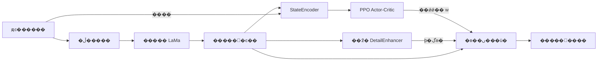

# DEAR-PPO

### ���� PPO �Ķ���ͼ���޸�ϸ����ǿ

**��������** | [English](README_EN.md)

DEAR-PPO ��Ԥѵ���� **LaMa** ͼ���޸�ģ��֮������ **PPO��Proximal Policy Optimization�����˲����Ż���**������ͼ��״̬ѡ��ϸ����ǿǿ�ȣ�̽������ͼ��������������������۸е�ƽ�⡣

��Ŀ���á�**LaMa �����޸� �� �̶���߶�ϸ����ȡ �� PPO ����Ӧǿ�ȿ���**�������̣���ѵ�������� Actor-Critic ���磬LaMa ���ɱ��ֶ��ᡣ

[�޸�Ч��](#�޸�Ч��) �� [����](#����) �� [���ٿ�ʼ](#���ٿ�ʼ) �� [ʵ���¼](#ʵ���¼) �� [�������������](#�������������)

## �޸�Ч��

����ͼƬֱ�����Բֿ�� [`outputs/repaired/`](outputs/repaired) �ļ��С�**ÿ��ͼ����������Ϊ��ԭͼ���ο������ڵ�������޸������** �м�ͼ�ĺ�ɫ�����ʾ���޸����ݣ��Ҳ�Ϊ LaMa + PPO ϸ����ǿ���̵������

### ���� 1���ֲ��ڵ��޸�


ͷ���Ϸ����ڵ�����õ���ȫ������ɫ����������Ϊ��Ȼ�������ڹ۲�ֲ�ȱ������Χ���ݵ��νӡ�

### ���� 2�����ӷ���������


�����ڵ��������������������޸����Կɼ��ֲ��ṹʧ��ͽ�ǿ���񻯺ۼ���չʾ�˸������������е����ѡ�

### ���� 3��ͷ�����沿�������ڵ�


�ڵ������ò�ȫ�������ַ�˿����������ƫӲ�������ڹ۲�ϸ����ǿ�Ի���һ���Ե�Ӱ�졣

> ��ЩͼƬ����չʾ�������̵Ķ��Ա��֣�δ�����г�ԭʼ LaMa �������˲����ɡ�ԭʼ LaMa �� PPO ��ǿ�������ڶԱȡ�����Ҳδ�������Ե� checkpoint��������ӻ�ָ���¼��

## ����

### ϵͳ����



���������

$$
I_{\mathrm{final}}=\operatorname{clip}\left(\hat{I}+w\,R(\hat{I}),\,0,\,1\right),\qquad w\in[0,1]
$$

���У�$\hat{I}$ �� LaMa �ij����޸������$R$ �ǹ̶��Ķ�߶�ϸ�ڲв$w$ �Dz�������Ϊÿ��ͼ��ѡ��ı���ǿ�ȡ���ǰʵ�ֽ���ǿӦ��������ͼ��

| ģ�� | ���� | ��ǰѵ��״̬ |
| --- | --- | --- |
| `LamaWrapper` | ���� TorchScript LaMa�����ɳ����޸���� | Ԥѵ���������� |
| `DetailEnhancer` | �����߶ȵĸ�˹����ϸ����ȡ���߶�Ȩ��Ϊ 0.6 / 0.3 / 0.1 | �޿�ѧϰ���� |
| `StateEncoder` | 4 ����� + ����Ӧ�ػ� + ȫ���ӣ����޸�ͼ���������Ϊ 256 ά״̬ | �����ʼ���󶳽� |
| `ActorCritic` | Ԥ����ǿǿ�ȼ�״̬��ֵ | **Ψһ�� PPO �Ż�������** |
| `RewardComputer` | ������������֪����Ե��Ƶ�ʺ���Ƚ��� | ����������Ż� |

### ������ PPO ѵ��

- **ͼ��Ԥ����**�����ֳ����ȣ����������ŵ� 256 ���أ������Ҳࡢ�ײ������� 256 �� 256��
- **���Ӷȸ�֪����**���� Sobel �ݶȹ���ͼ���Ӷȣ�Ŀ���ڵ�����Ϊ `0.11 - 0.10 �� complexity`���ϵ͸��ӶȲ��������ڵ����ϸ߸��ӶȲ��þ��Ρ�Բ�λ���Բ��ʵ��������ܳߴ�ͱ߽�Լ����
- **��������**��ÿ��ͼ�����һ����ǿ���ߣ����� `done=True` д�� rollout ������������ʹ�� PPO �ü�Ŀ�ꡢ��ֵ��ʧ����������¡�
- **��������**��ʹ�� Actor ����ľ�ֵ��Ϊ��ǿǿ�ȣ�����������������ɡ�

### ��������

```text
reward = 1.0 �� SSIM + 0.5 �� (PSNR / 40)
       - 1.2 �� VGG��֪���� - 0.5 �� ��Ե��ʧ - 0.5 �� Ƶ����ʧ
       + 0.8 �� (��� / 10)
```

ʵ�ּ� [`rl.py`](rl.py)�����е���־�ֶ� `lpips` ʵ�ʶ�Ӧ **VGG16 ��������� L1 ����**�����DZ�׼ LPIPS��`psnr` �� `sharp` ��־�ֶηֱ��ѳ��� 40 �� 10������������ָ��������Ŵ������ͼ���ϼ��㡣

## ���ٿ�ʼ

### 1. ��ȡ����������

```bash
git clone https://github.com/ZerothXX/DEAR-PPO.git
cd DEAR-PPO
python -m venv .venv
```

�������⻷���󣬰�װ�뱾�� CUDA / CPU ����ƥ��� `torch`��`torchvision`���Լ�����������

```bash
python -m pip install torch torchvision numpy Pillow opencv-python matplotlib tqdm
```

�ű��Զ�ѡ�� CUDA������ʱ���� CPU���ֿ���δ�ṩ�����汾�������ļ���Ĭ�����ø�֪����ʱ��Torchvision ��������Ԥѵ�� VGG16 Ȩ�ء�`--no_perceptual` �ɹرո������ı佱�����á�

### 2. ׼�� LaMa Ȩ��

�� [anime-big-lama](https://huggingface.co/df1412/anime-big-lama) ��ȡ `anime-manga-big-lama.pt`��������Ŀ��Ŀ¼����ͨ�� `--lama_path` ָ����·������Ȩ���� `torch.jit.load` ���أ���ʹ�ü��ݵ� TorchScript �ļ���

### 3. ׼������

��Ŀʹ�� [Danbooru2024-SFW](https://huggingface.co/datasets/deepghs/danbooru2024-sfw/tree/main/images) �� `0999`��`0777`��`0117` �Ӽ����ֿ�������ݻ����嵥��ԭʼͼƬ�����л�ȡ��������

```text
DEAR-PPO/
������ anime-manga-big-lama.pt       # ��������
������ dataset/
��   ������ img1/                    # ����׼�� JPG ͼ��
��   ������ img2/
��   ������ img3/
��   ������ train.txt
��   ������ val.txt
��   ������ test.txt
������ outputs/
    ������ models/
        ������ checkpoint_best.pt
```

ÿ�������ļ�һ��һ������� `dataset/` ��ͼ��·�������� `img3/5726.jpg`��`--data_root` ָ��**���� `dataset/` ����ĿĿ¼**������ `dataset/` ������

��ǰ�嵥�� 18,518 �ţ�ѵ���� 12,962 �š���֤�� 3,703 �š����Լ� 1,853 �ţ�ԼΪ **70% / 20% / 10%��ѵ�� / ��֤ / ���ԣ�**�����������»��֣��ɲο� [`dataset/data/data.py`](dataset/data/data.py) �� [`dataset/data/data2.py`](dataset/data/data2.py)���Ⱥ˶�����Ŀ¼��ִ��λ�ü���Ź���ȷ���嵥��ʵ��ͼ��һ�¡�

### 4. ѵ��

����Ŀ��Ŀ¼ִ�����������ʽָ��·���ɸ��Ǵ�����ԭ�еı�������·��Ĭ��ֵ������дΪ���У������� PowerShell �� Bash��

```bash
python train.py --data_root . --lama_path ./anime-manga-big-lama.pt --model_dir ./outputs/models --curves_dir ./outputs/curves --masks_dir ./outputs/masks --repaired_dir ./outputs/repaired --epochs 20
```

ѵ�����������

- `outputs/models/checkpoint_best.pt`���� **epoch ƽ��ѵ������**ѡ������Ų��ԡ�
- `outputs/models/checkpoint_final.pt`�����һ�� epoch �IJ��ԡ�
- `outputs/curves/`����������ʧ��������ϸ�����߼� `metrics_history.json`��
- `outputs/masks/`��`outputs/repaired/`���������������������

### 5. ����

```bash
python eval.py --data_root . --lama_path ./anime-manga-big-lama.pt --checkpoint ./outputs/models/checkpoint_best.pt --output_dir ./outputs/eval --split val --max_samples 50
```

�ն���� Reward��SSIM����һ�� PSNR��VGG ��֪���루��־�� `LPIPS`���� $w$ �ľ�ֵ���׼�����ͼ������ `outputs/eval/samples/`��ǿ�ȷֲ�ͼ����Ϊ `outputs/eval/w_distribution.png`��`--max_samples` �����Ʊ����ͼƬ������ָ���Ա���������ѡ���֡��� `--split val` ��Ϊ `--split test` ���ڲ��Լ���������

## ʵ���¼

### ������֤����¼

�±�������Ŀԭ README ��ʵ���¼��**���DZ����������еõ��Ľ��**���ֿ�δ����Ӧ������������־����ֵ���ο���

| ָ�� | �Ѽ�¼��ֵ | ���� |
| --- | --- | --- |
| SSIM �� | 0.9675 | ��ͼ�ṹ������ |
| VGG ��֪���� �� | 0.0822 | ԭ�ļ�Ϊ LPIPS����ǰʵ�ֲ��DZ�׼ LPIPS |
| ƽ����ǿǿ�� $w$ | 0.0007 | �������������ϸ����ǿ |

### ��������ǿǿ�ȱ仯


����ѵ�������У�ƽ����������������ƽ����ǿǿ���½����ӽ��㡣�������ļ�¼�������ڸý��������������� LaMa �Ļ���������Ƿ�����ԭʼ LaMa����������ͬ���ݺ͹̶������½�������������

### Ĭ��ѵ������

�����Ե�ǰ [`train.py`](train.py) ��������Ĭ��ֵΪ׼��

| ���� | Ĭ��ֵ |
| --- | --- |
| ͼ��ߴ� / batch size | 256 �� 256 / 16 |
| PPO ѧϰ�� | `2e-5` |
| �ۿ����� �� / GAE �� | 0.9 / 0.95 |
| PPO �ü���ֵ / �������� | 0.15 / 5 |
| PPO mini-batch / ���������� | 64 / 4096 |
| ״̬ά�� | 256 |
| ѵ�� epochs / ��֤��� | 20 / ÿ 5 �� epoch |

## ���뵼��

| �ļ� | ���� |
| --- | --- |
| [`models.py`](models.py) | LaMa ��װ��ϸ����ǿ��״̬�������� Actor-Critic |
| [`data_mask.py`](data_mask.py) | ���ݼ��ء����Ų����븴�Ӷȸ�֪���� |
| [`rl.py`](rl.py) | PPO ���¡�rollout ���������������� |
| [`train.py`](train.py) | ѵ����������֤��checkpoint ���� |
| [`eval.py`](eval.py) | ���ݼ�����������ͼ��ǿ�ȷֲ�ͼ |
| [`utils.py`](utils.py) | ָ���¼�����߻����뱣�湤�� |
| [`outputs/repaired/`](outputs/repaired) | ��ҳʹ�õ��޸�Ч������ |

## �������������

- **���������뻭��һ����**�����Ρ��沿����˿�������Կ��ܲ����ṹʧ�棬��ǿ��ϸ����ǿҲ����ʹ����ƫӲ��
- **�����д�����**����ǰչʾȱ��ԭʼ LaMa �벻ͬ�̶���ǿǿ�ȵĶ��գ���ͼָ��Ҳ��������С����ڵ��е�������Ӧ����̶����롢�޸�����ָ��ͱ�׼ LPIPS ������
- **״̬��������������**����ǰ�����������ʼ���󶳽ᣬcheckpoint ������ Actor-Critic ���Ż�����`eval.py` �����³�ʼ�����������ϸ����豣�沢�ָ�ͬһ��������ͬʱ�̶� Python��NumPy��PyTorch ������Ӽ��������롣

## ��л

��л [LaMa](https://github.com/advimman/lama)��[anime-big-lama](https://huggingface.co/df1412/anime-big-lama) �� [Danbooru2024-SFW](https://huggingface.co/datasets/deepghs/danbooru2024-sfw) �ṩ��ģ�͡�������������Դ��
