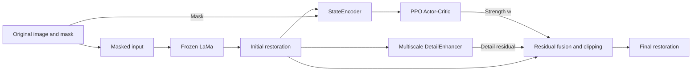

# DEAR-PPO

### PPO-Guided Detail Enhancement for Anime Image Inpainting

[��������](README.md) | **English**

DEAR-PPO adds **PPO (Proximal Policy Optimization)** after a pretrained **LaMa** inpainting model to select a detail enhancement strength from image features. It explores the balance between line clarity, texture, and overall visual consistency in anime images.

The pipeline is **LaMa inpainting �� fixed multiscale detail extraction �� PPO-guided strength selection**. Only the lightweight Actor-Critic network is trained; the LaMa backbone remains frozen.

[Visual Results](#visual-results) �� [Method](#method) �� [Quick Start](#quick-start) �� [Experiment Records](#experiment-records) �� [Limitations and Next Steps](#limitations-and-next-steps)

## Visual Results

The images below come directly from [`outputs/repaired/`](outputs/repaired). **Each image reads from left to right: original reference | masked input | restored output.** Black regions in the middle panel indicate missing content. The right panel shows the output of the LaMa + PPO detail enhancement pipeline.

### Example 1: Local Occlusion


The missing region near the top of the hair is filled with relatively consistent colors and contours, illustrating how a local repair connects to its surroundings.

### Example 2: Complex Clothing and Texture


A horizontal strip crosses clothing and the body. Local structural distortion and strong sharpening remain visible in the output, illustrating the difficulty of restoring complex textures.

### Example 3: Occlusion Around Hair and Faces


The missing region is filled, but some hair strands and contours appear harsh. This example illustrates how detail enhancement can affect stylistic consistency.

> These images illustrate the complete pipeline. They do not include a separate LaMa-only output and therefore are not a LaMa-versus-PPO ablation. Per-example checkpoints, random seeds, and metric logs are not attached.

## Method

### Pipeline



The final output is:

$$
I_{\mathrm{final}}=\operatorname{clip}\left(\hat{I}+w\,R(\hat{I}),\,0,\,1\right),\qquad w\in[0,1]
$$

Here, $\hat{I}$ is the initial LaMa output, $R$ is a fixed multiscale detail residual, and $w$ is a scalar strength selected per image by the policy. The current implementation applies enhancement to the entire image.

| Module | Role | Current training status |
| --- | --- | --- |
| `LamaWrapper` | Loads TorchScript LaMa and generates the initial restoration | Pretrained parameters frozen |
| `DetailEnhancer` | Three-scale Gaussian unsharp masking with weights 0.6 / 0.3 / 0.1 | No learnable parameters |
| `StateEncoder` | Four convolutional layers, adaptive pooling, and a fully connected layer encode the restoration and mask into a 256-dimensional state | Randomly initialized and frozen |
| `ActorCritic` | Predicts enhancement strength and state value | **The only network optimized by PPO** |
| `RewardComputer` | Computes quality, perceptual, edge, frequency, and sharpness terms | Not optimized |

### Masks and PPO Training

- **Image preprocessing:** resize the longer side to 256 pixels while preserving the aspect ratio, then pad the right and bottom with black to obtain 256 �� 256 images.
- **Complexity-aware masks:** estimate image complexity using Sobel gradients, with a target mask ratio of `0.11 - 0.10 �� complexity`. Lower complexity uses strip masks; higher complexity uses rectangles, circles, or ellipses. Actual coverage also depends on size and boundary constraints.
- **Single-step decisions:** each image receives one enhancement action and is stored with `done=True` in the rollout buffer. The policy is updated using the PPO clipped objective, value loss, and entropy regularization.
- **Evaluation policy:** use the Actor's mean output as the enhancement strength. Evaluation masks are still generated randomly.

### Reward Function

```text
reward = 1.0 �� SSIM + 0.5 �� (PSNR / 40)
       - 1.2 �� VGG perceptual distance - 0.5 �� edge loss - 0.5 �� frequency loss
       + 0.8 �� (sharpness / 10)
```

See [`rl.py`](rl.py) for the implementation. The log field `lpips` is actually an **L1 distance between multilevel VGG16 features**, not standard LPIPS. The `psnr` and `sharp` log fields are already divided by 40 and 10, respectively. Rewards and quality metrics are computed over the entire processed image.

## Quick Start

### 1. Get the Code and Dependencies

```bash
git clone https://github.com/ZerothXX/DEAR-PPO.git
cd DEAR-PPO
python -m venv .venv
```

After activating the environment, install `torch` and `torchvision` for your CUDA / CPU setup, along with the remaining dependencies:

```bash
python -m pip install torch torchvision numpy Pillow opencv-python matplotlib tqdm
```

The scripts automatically select CUDA when available, otherwise CPU. The repository does not yet pin dependency versions. Perceptual rewards are enabled by default and Torchvision also downloads pretrained VGG16 weights. Use `--no_perceptual` to disable that term, which changes the reward configuration.

### 2. Prepare LaMa Weights

Obtain `anime-manga-big-lama.pt` from [anime-big-lama](https://huggingface.co/df1412/anime-big-lama). Place it in the project root or provide its location with `--lama_path`. The model is loaded with `torch.jit.load`, so a compatible TorchScript file is required.

### 3. Prepare the Dataset

The project uses the `0999`, `0777`, and `0117` subsets of [Danbooru2024-SFW](https://huggingface.co/datasets/deepghs/danbooru2024-sfw/tree/main/images). Split lists are included; source images must be obtained and organized separately.

```text
DEAR-PPO/
������ anime-manga-big-lama.pt       # Download separately
������ dataset/
��   ������ img1/                    # Supply JPG images separately
��   ������ img2/
��   ������ img3/
��   ������ train.txt
��   ������ val.txt
��   ������ test.txt
������ outputs/
    ������ models/
        ������ checkpoint_best.pt
```

Each split file contains one image path per line, relative to `dataset/`, such as `img3/5726.jpg`. Set `--data_root` to the **project directory containing `dataset/`**, rather than `dataset/` itself.

The current lists contain 18,518 images: 12,962 training, 3,703 validation, and 1,853 test images, approximately **70% / 20% / 10% (train / validation / test)**. To create a new split, refer to [`dataset/data/data.py`](dataset/data/data.py) and [`dataset/data/data2.py`](dataset/data/data2.py). Check their input directories, working directory, and filename numbering before use so that split lists match the actual images.

### 4. Train

Run the following from the project root. Explicit paths override the original machine-specific absolute defaults in the code. The command is written on one line for both PowerShell and Bash.

```bash
python train.py --data_root . --lama_path ./anime-manga-big-lama.pt --model_dir ./outputs/models --curves_dir ./outputs/curves --masks_dir ./outputs/masks --repaired_dir ./outputs/repaired --epochs 20
```

Training produces:

- `outputs/models/checkpoint_best.pt`: the policy selected by **mean training reward per epoch**.
- `outputs/models/checkpoint_final.pt`: the policy from the last epoch.
- `outputs/curves/`: reward, loss, quality, and detail curves, plus `metrics_history.json`.
- `outputs/masks/` and `outputs/repaired/`: masks and three-panel comparison images.

### 5. Evaluate

```bash
python eval.py --data_root . --lama_path ./anime-manga-big-lama.pt --checkpoint ./outputs/models/checkpoint_best.pt --output_dir ./outputs/eval --split val --max_samples 50
```

The terminal reports means and standard deviations for Reward, SSIM, normalized PSNR, VGG perceptual distance (logged as `LPIPS`), and $w$. Comparison images are saved under `outputs/eval/samples/`, and the strength histogram is saved as `outputs/eval/w_distribution.png`. `--max_samples` limits saved images only; metrics cover the entire selected split. Use `--split test` instead of `--split val` to evaluate on the test set.

## Experiment Records

### Existing Validation Record

The values below are retained from the original project README. **They were not recomputed for this documentation update.** The repository does not include the corresponding full evaluation log, so these values are provided for reference.

| Metric | Recorded value | Interpretation |
| --- | --- | --- |
| SSIM �� | 0.9675 | Full-image structural similarity |
| VGG perceptual distance �� | 0.0822 | Previously labeled LPIPS; the current implementation is not standard LPIPS |
| Mean enhancement strength $w$ | 0.0007 | The policy favors weak detail enhancement |

### Reward and Enhancement Strength


In the existing training curve, smoothed reward rises while mean enhancement strength falls toward zero. Together with the record above, this suggests that the policy favors retaining the base LaMa output under this reward configuration. An ablation with identical data and fixed masks is still needed to determine whether it improves over LaMa alone.

### Default Training Parameters

These values follow the current command-line defaults in [`train.py`](train.py).

| Parameter | Default |
| --- | --- |
| Image size / batch size | 256 �� 256 / 16 |
| PPO learning rate | `2e-5` |
| Discount �� / GAE �� | 0.9 / 0.95 |
| PPO clip threshold / update epochs | 0.15 / 5 |
| PPO mini-batch / buffer capacity | 64 / 4096 |
| State dimension | 256 |
| Training epochs / validation interval | 20 / every 5 epochs |

## Code Guide

| File | Contents |
| --- | --- |
| [`models.py`](models.py) | LaMa wrapper, detail enhancer, state encoder, and Actor-Critic |
| [`data_mask.py`](data_mask.py) | Dataset loading, resizing, padding, and complexity-aware masks |
| [`rl.py`](rl.py) | PPO updates, rollout buffer, and rewards |
| [`train.py`](train.py) | Training, periodic validation, and checkpoint saving |
| [`eval.py`](eval.py) | Dataset evaluation, comparison images, and strength histogram |
| [`utils.py`](utils.py) | Metric tracking, plots, and saving utilities |
| [`outputs/repaired/`](outputs/repaired) | Restoration examples displayed on this page |

## Limitations and Next Steps

- **Complex regions and style consistency:** clothing, faces, and hair can still exhibit structural distortion. Strong enhancement can also make lines look harsh.
- **Improvement remains to be quantified:** the current gallery lacks LaMa-only and fixed-strength baselines. Full-image metrics may also understate errors in small masked regions. Future evaluation should use fixed masks, masked-region metrics, and standard LPIPS.
- **State encoder reproducibility:** the encoder is randomly initialized and frozen, while checkpoints save only the Actor-Critic and optimizer. `eval.py` initializes a new encoder. Strict reproduction requires saving and restoring the same encoder and fixing Python, NumPy, and PyTorch seeds as well as evaluation masks.

## Acknowledgments

Thanks to [LaMa](https://github.com/advimman/lama), [anime-big-lama](https://huggingface.co/df1412/anime-big-lama), and [Danbooru2024-SFW](https://huggingface.co/datasets/deepghs/danbooru2024-sfw) for the models, methods, and data resources.
